# AI StoryBuilders user guide

AI StoryBuilders helps you plan and write a novel with an AI model. You keep the story's characters, locations and timelines in one place. The AI uses them to write sections that stay consistent with your story.

There are two versions with the same screens:

- **Browser version**: runs in your web browser at `<online-app-url>`. Nothing to install.
- **Windows version**: a desktop app for Windows, from `<store-or-download-link>`.

Where the two versions behave differently, this guide says so.

## Before you start

You need:

| What | Details |
|---|---|
| An AI provider | An account and API key with **OpenAI**, **Azure OpenAI**, **Anthropic** or **Google AI**. Or a computer that runs **Ollama**, which needs no key. |
| A capable model | The app tests each model before you can use it. The model must be able to call tools and return structured answers. Small or older models may fail the test. |
| For Azure OpenAI | Your endpoint URL (`https://<resource>.openai.azure.com/`) and your model deployment name. |
| For Ollama | The endpoint URL of the computer running Ollama (`http://<ollama-host>:11434/`). |
| Browser version | A current desktop browser. Stories are kept in that browser's storage, which holds about 5 MB. |
| Windows version | Windows 10 (version 2004) or later. |
| Optional | An existing manuscript (`.docx`, `.pdf`, `.txt` or `.md`), or a project exported from AI StoryBuilders (`.stybld`). |

There are no user accounts, sign-in or roles. Everyone who opens the app on a computer or browser sees the same stories and settings.

> **Note:** Text that the AI reads is sent to the provider you choose. Ollama keeps everything on the computer that runs it. Embeddings (used to search your story) are always made on your own computer.

## How it works

You connect an AI provider once. Then you create a story, or import a manuscript, and the AI drafts the characters, locations, timelines and chapters. You refine those story elements, then write each chapter section by section. You can write a section yourself or ask the AI to write it. The **Chat** tab answers questions about your story and can propose changes to the story and to its knowledge base pages. The **Knowledgebase** tab holds your own reference notes, which the AI can search when you ask it to.

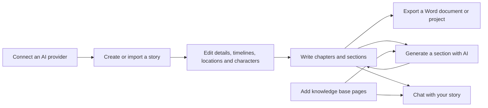

## 1. Connect an AI provider

Do this first. Until a model is verified, you can't create or write stories. The first time you open the app, it takes you straight to **Settings**.

1. Click **Settings** in the top menu.
2. In **AI Provider:**, pick your provider.

   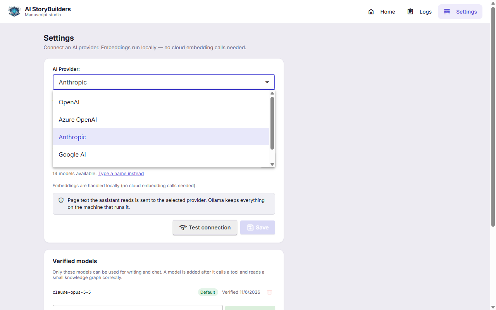

3. Paste your key in **API Key:**. If you don't have one, click the red button, for example **An Anthropic API Key is required (Click here to get one)**. It opens the provider's website.
4. For **Azure OpenAI** or **Ollama**, enter the endpoint URL.
5. Pick a model from the model list. If the list doesn't load, click **Type a name instead** and type the model or deployment name. Click the refresh button next to the list to reload it.
6. Optional: click **Test connection** to check the key and model.
7. Click **Save**. The button shows **Verifying model…** while the app tests the model.

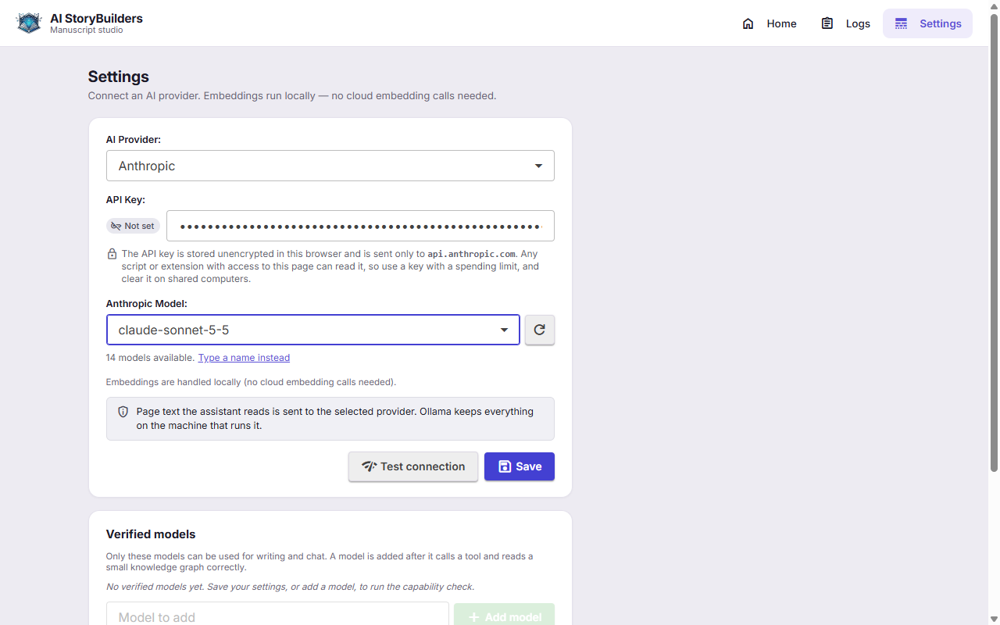

**What you should see:** a **Settings saved** message, then **Model verified**. **API Key:** shows **Configured**, and the model appears under **Verified models** marked **Default**. On your first visit, the app then takes you to the story library.

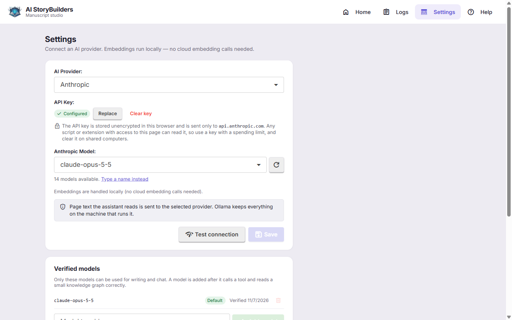

### Manage verified models

Only models in **Verified models** appear in the app's model lists.

- To add another model, pick or type it under **Model to add**, then click **Add model**. The app tests it first.
- To remove a model, click its delete icon and click **Yes**. You can't remove the default model. Pick another default first.
- To change the default model, pick it in the model list at the top and click **Save**.
- To change your key, click **Replace**. To remove it, click **Clear key**.

> **Where your key is kept:** In the browser version, the key is stored unencrypted in this browser and is sent only to your provider. Use a key with a spending limit, and click **Clear key** on shared computers. In the Windows version, the key is kept in Windows secure storage and is never shown again.

In the browser version, Settings also shows **Browser storage**: how much of the browser's space (about 5 MB) your stories use.

## 2. Create a story

Use this to start a new story from a short idea. The AI drafts the characters, locations, timelines and the first section of each chapter.

1. Click **Home**.
2. Click **New Story**.

   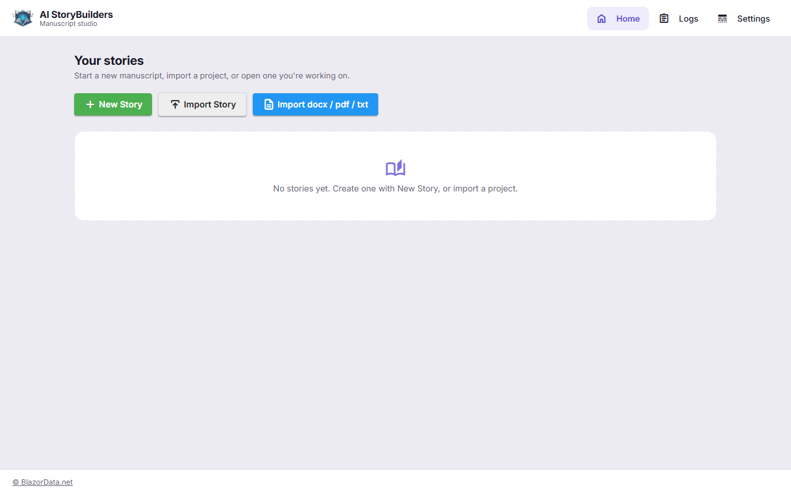

3. Type a **Story Title:** of up to 20 characters.
4. Type a **Short Story Synopsis:** of a few sentences. In the browser version, you can click the microphone button to dictate it.
5. Pick the number of **Chapters:** (1, 2 or 3).
6. Pick the **AI Model:**.
7. Click **Create Story**.

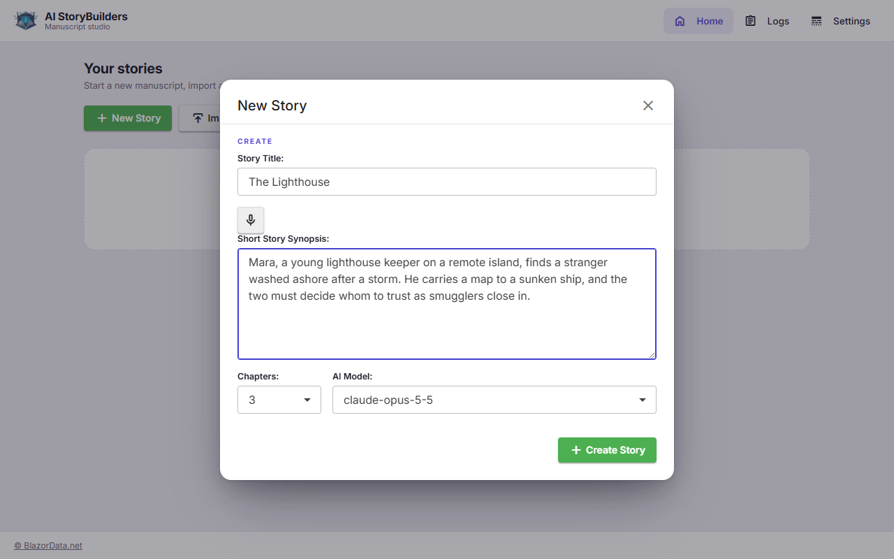

**What you should see:** a progress bar on the library while the AI works. Messages such as **Create the Character files** and **Create Chapter 1** appear in the corner. This can take a minute or more. When it finishes, the story opens on the **Chapters** tab.

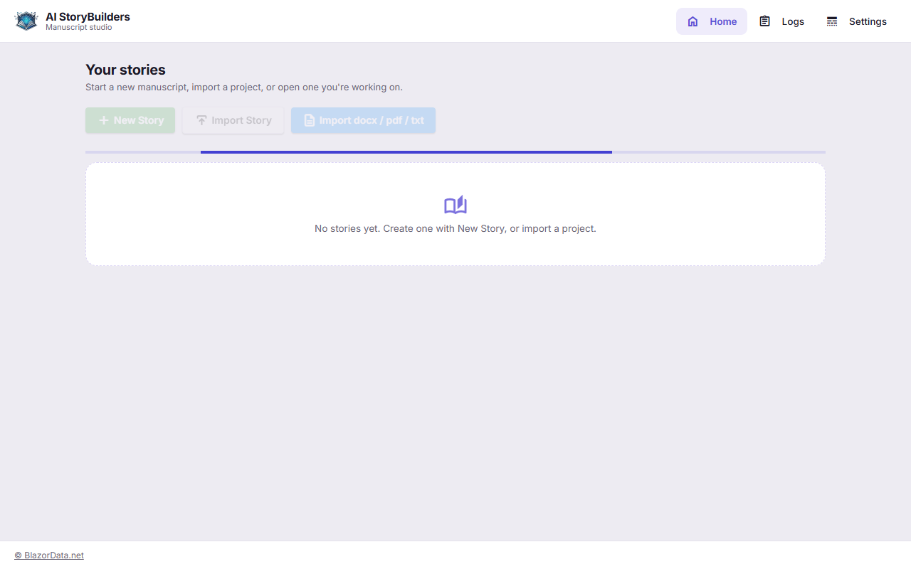

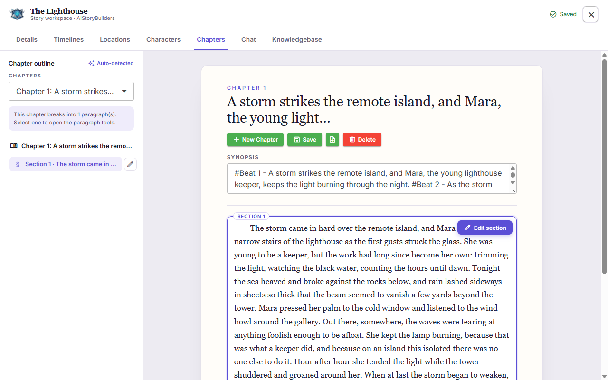

## 3. Import an existing manuscript

Use this when you already have a draft. The AI splits it into chapters and sections and finds the characters, locations and timelines.

1. Click **Home**.
2. Click **Import docx / pdf / txt**.
3. Choose a `.docx`, `.pdf`, `.txt` or `.md` file of up to 50 MB.

   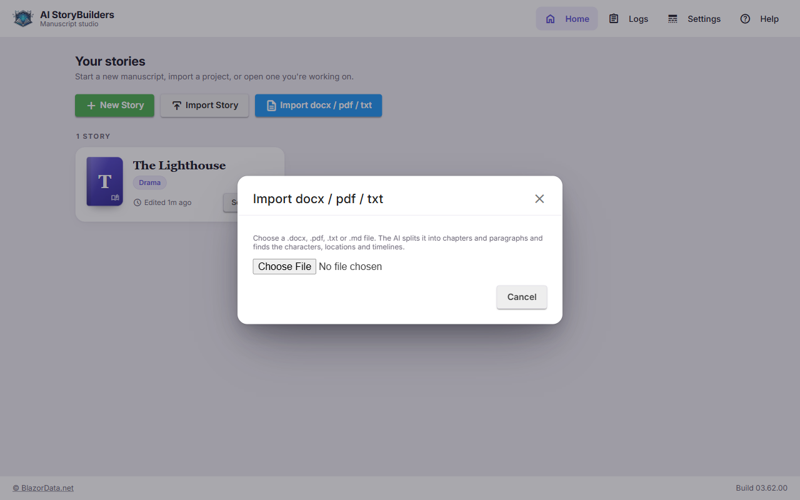

**What you should see:** a progress bar with the current step, for example **Chapter 1/2: Generating summary…**. Long manuscripts take several minutes. When it finishes, the story opens on the **Chapters** tab. The story takes its title from the file name.

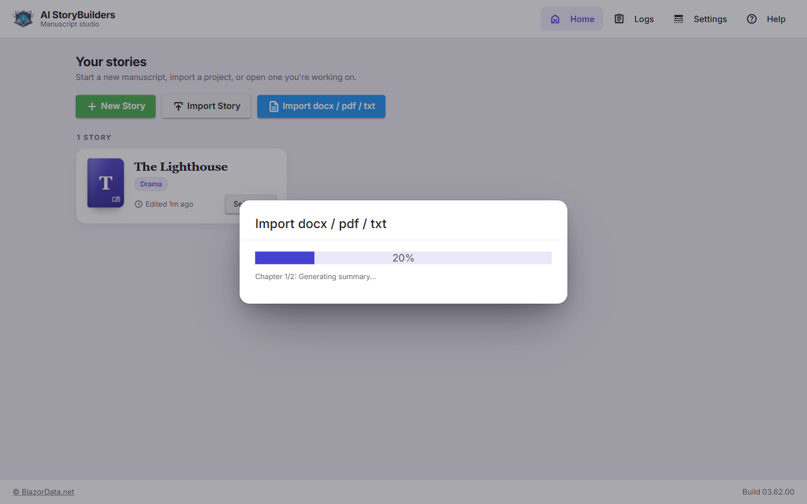

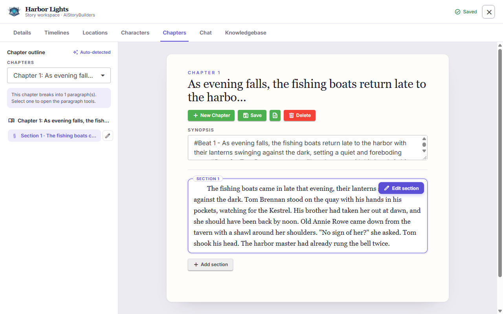

## 4. Open a story and find your way around

Your stories are listed on the **Home** page. Each card shows the title, the story style and when you last edited it.

1. Click a story card, or its **Select** button.
2. Use the tabs to move around: **Details**, **Timelines**, **Locations**, **Characters**, **Chapters**, **Knowledgebase** and **Chat**.
3. When you're done, click the **X** (**Close workspace**) at the top right to return to the library.

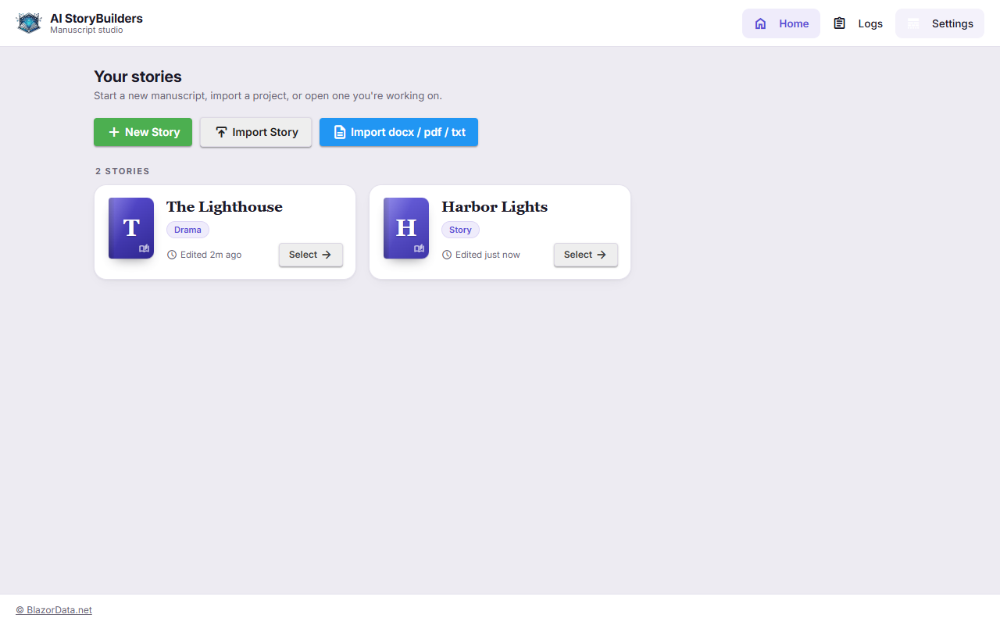

**What you should see:** the story title at the top left, and a save indicator at the top right.

- The Windows version saves every change at once and always shows **Saved**.
- The browser version shows **Saving…**, **Unsaved** or **Saved**. If it shows **Save failed**, click **Retry**. Your changes are saved when you close the story.

## 5. Set the story details

Use the **Details** tab to set the style and the instructions the AI follows for the whole story.

1. Click the **Details** tab.
2. Pick a **Style:**, such as **Drama**, **Fantasy** or **Mystery**.
3. Edit the **Synopsis:** if you need to.
4. Click the **+** on **System Message** to open it. This is the writing style sheet the AI follows, such as point of view and tense. Edit it to suit your story.
5. Click the **+** on **World Facts** to open it. Type facts that must always hold in your story, one per line. For example: *Magic is illegal in the Northern Kingdom*.
6. Click **Save**.

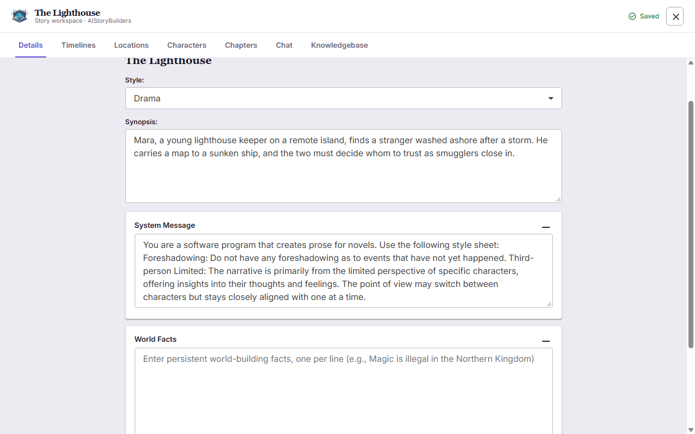

**What you should see:** the message **Story** / **Updated!**.

The **Details** tab also has **Save Word Doc**, **Export Project**, **Delete** and **Re-load Story**. See [12. Export, back up and maintain a story](#12-export-back-up-and-maintain-a-story).

## 6. Add timelines

Timelines are the periods of your story. Sections, character backgrounds and location descriptions can each belong to a timeline, so the AI knows what's true at that point.

1. Click the **Timelines** tab.
2. Click **New Timeline**, or click **Edit** on a timeline.
3. Enter the **Timeline Name:** and a **Description:**.
4. Pick a **Start Date:** and, optionally, a **Stop Date:**.
5. Click **Save**.

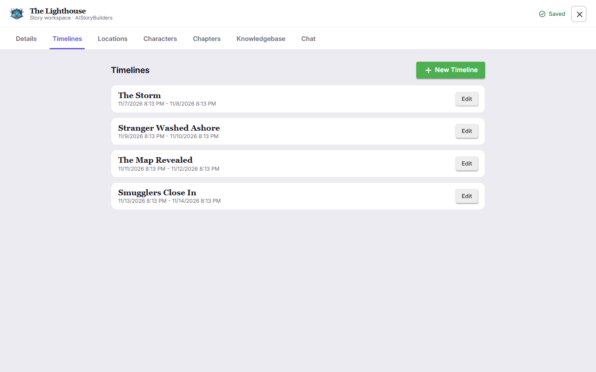

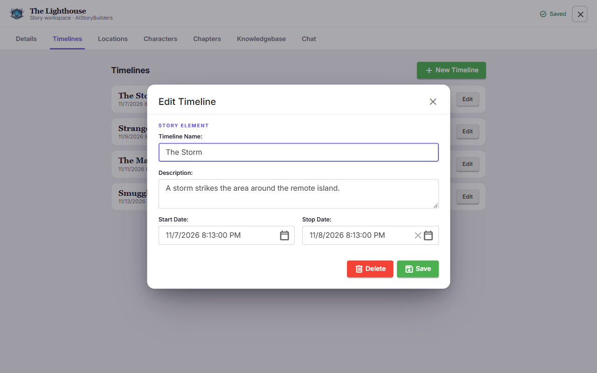

**What you should see:** the timeline in the list with its dates.

> **Note:** If you rename a timeline, the app asks you to confirm, then updates the name everywhere in the story. **Delete** removes the timeline from the whole story.

## 7. Add locations

1. Click the **Locations** tab.
2. Click **New Location**, or click **Edit** on a location.
3. Enter the **Location Name:**.
4. Click **New Description** to describe the place. Type the **Location Description:**, pick a **Timeline:** if the description is only true at that time, and click **Save**.
5. Click **Save** in the location dialog.

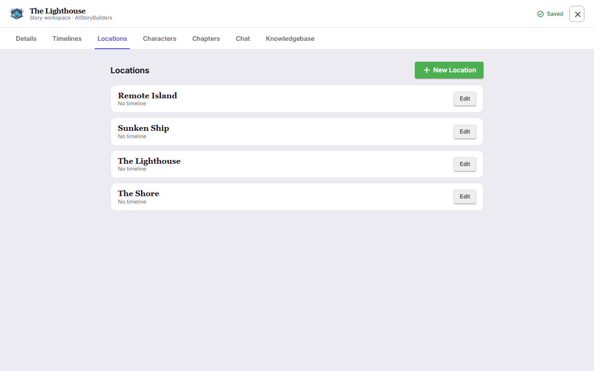

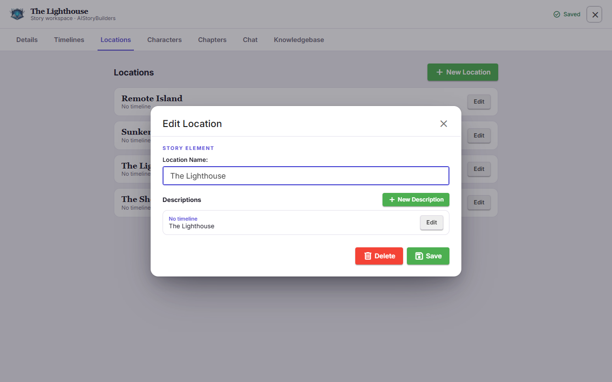

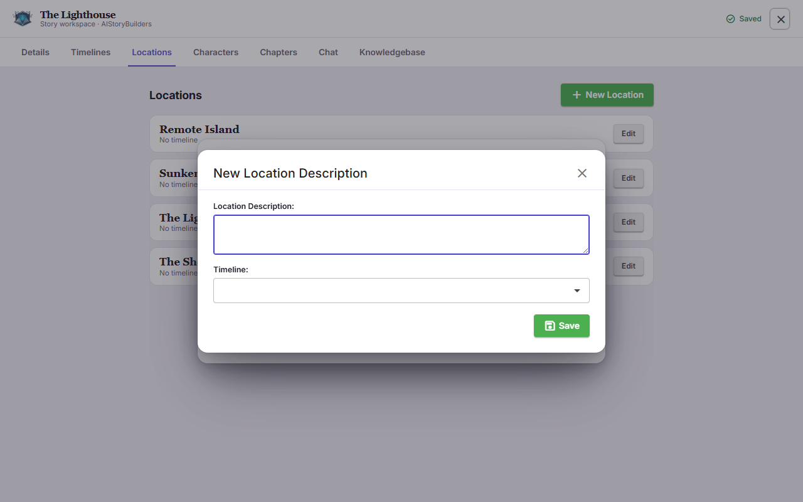

**What you should see:** the location in the list, with the timelines of its descriptions, or **No timeline**.

> **Note:** Descriptions aren't saved until you click **Save** in the location dialog. Renaming or deleting a location updates the whole story after you confirm.

## 8. Add characters

1. Click the **Characters** tab.
2. Click **New Character**, or click **Edit** on a character.
3. Enter the **Character Name:**.
4. To add a background detail, pick a **Background Type:** (**Appearance**, **Goals**, **History**, **Aliases** or **Facts**), then click **Add Background**.
5. Type the **Description:**, pick a **Timeline:** if needed, and click **Save**.
6. Click **Save** in the character dialog.

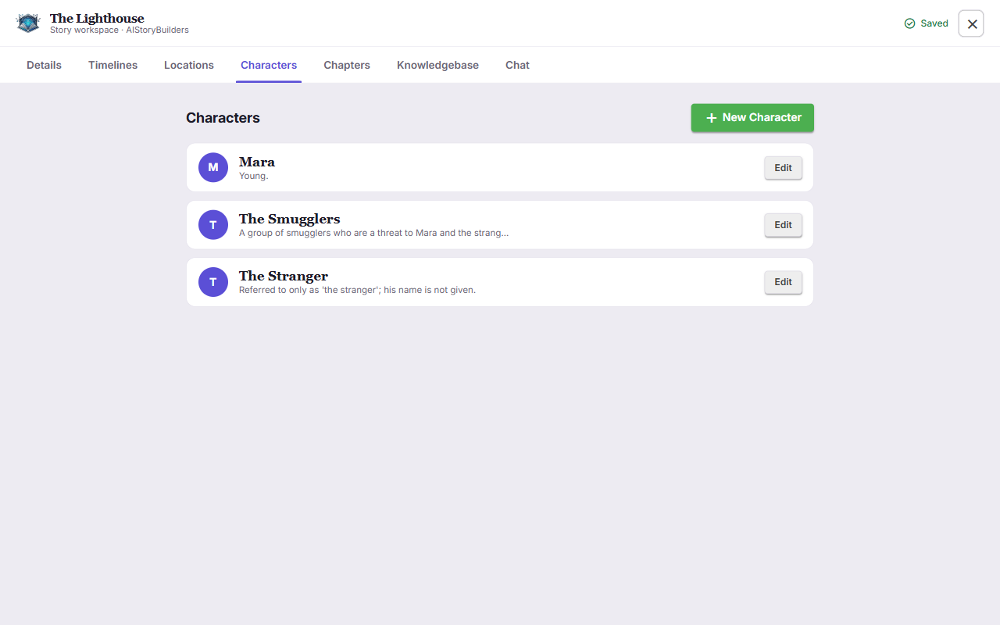

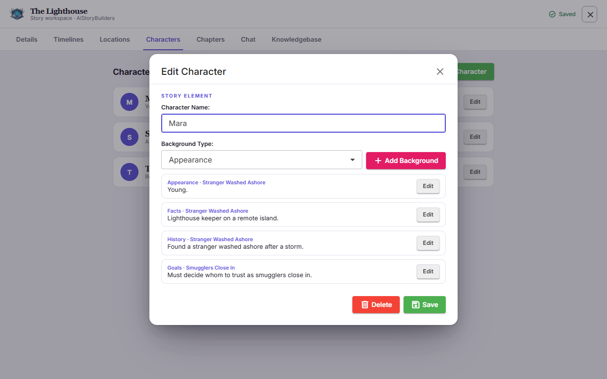

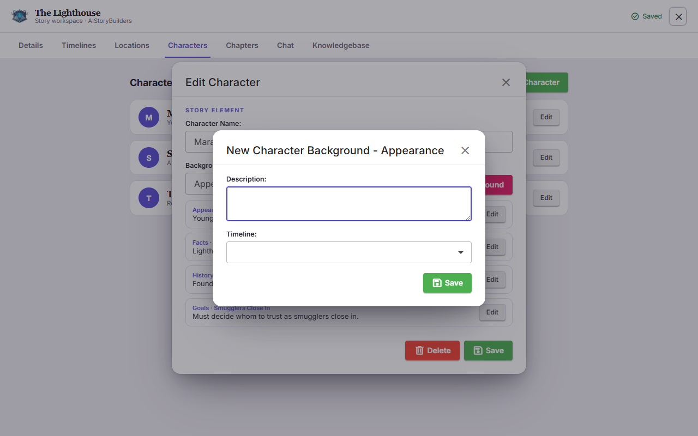

**What you should see:** the character in the list, with the start of its first background detail.

> **Note:** Background details aren't saved until you click **Save** in the character dialog. Renaming a character updates the whole story after you confirm.

## 9. Write chapters and sections

The **Chapters** tab is where you write. Each chapter has a synopsis and is made of sections (paragraphs).

### Work with chapters

1. Click the **Chapters** tab.
2. Pick a chapter from the **Chapters** list on the left, or click it in the outline.
3. Edit the chapter's **Synopsis** and click **Save**.

To add or remove chapters:

- **New Chapter** adds a chapter at the end. Type its **Synopsis:** (required) and click **Save**.
- The page icon next to **Save** (**Insert chapter before**) adds a chapter before the selected one, after you confirm.
- **Delete** removes the selected chapter after you confirm. It's hidden when the story has only one chapter.

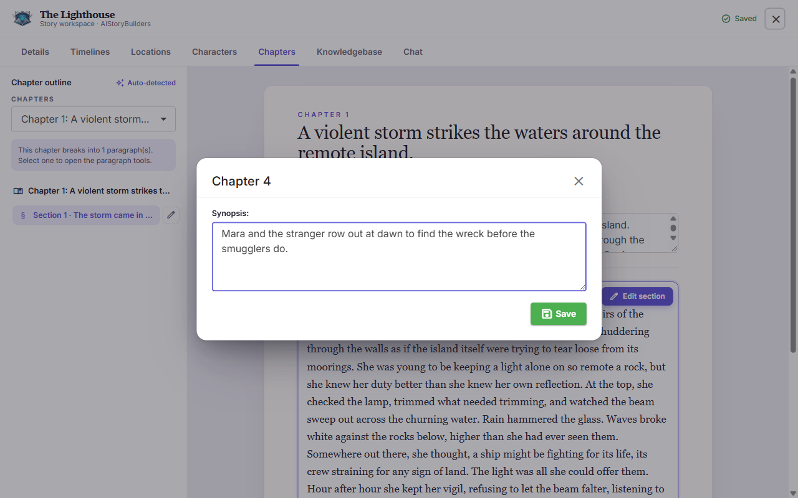

### Write or edit a section

1. Click a section to select it, then click **Edit section**. You can also double-click the section, or click the pencil next to it in the outline.
2. Type or edit the text. In the browser version, you can click the microphone button to dictate.
3. Click **Save**.

To add sections:

- **Add section** (below the last section) adds a new section at the end. It starts with the same characters, location and timeline as the section before it.
- **Add first paragraph** appears when a chapter is empty.
- In the editor, the page icon (**Add section above**) adds a blank section above this one.

To delete a section, open it and click the red delete icon (**Delete section**), then **Yes**.

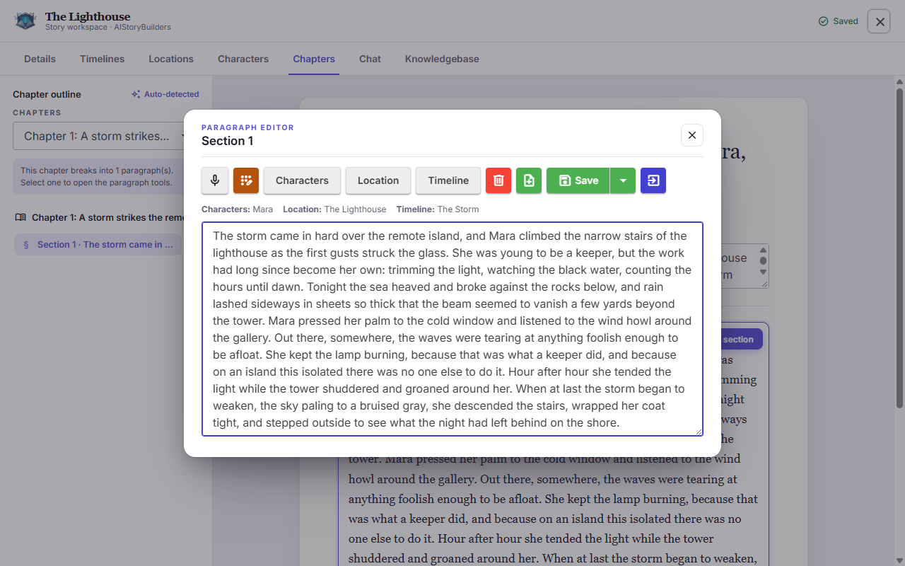

**What you should see:** the editor closes and the chapter shows your text. If you close the editor with unsaved changes, the app asks **Discard your changes to this section?**

### Set who and where a section is about

Each section can list its characters, its location and its timeline. The AI uses them when it writes.

1. In the editor, click **Characters**, **Location** or **Timeline**.
2. Check the characters, or pick the location or timeline. Pick **(none)** to clear it.
3. Click **Save** to go back to the editor. Click **Cancel** to keep the old choice.
4. Click **Save** in the editor to keep the change.

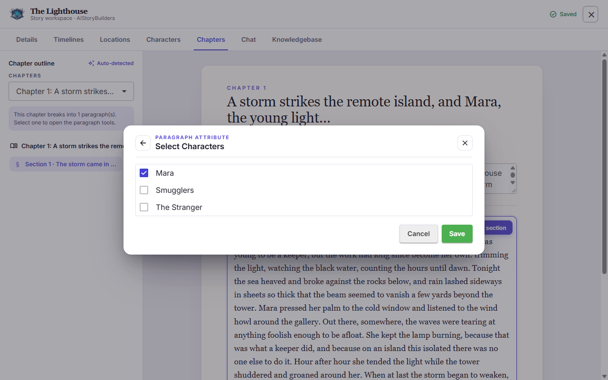

### Detect characters and details automatically

1. In the editor, click the arrow next to **Save**.
2. Click **Autodetect Attributes**.
3. The AI reads the section and lists new characters and new details about existing ones. Check the ones you want.
4. Click **Add Characters and Attributes**.

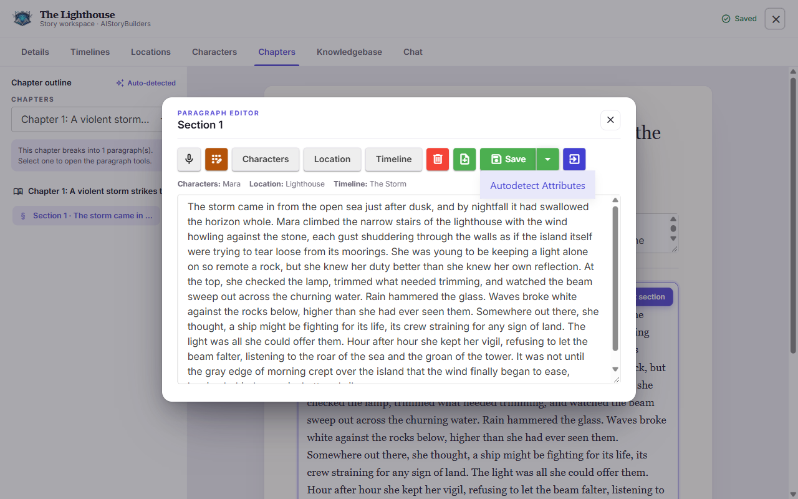

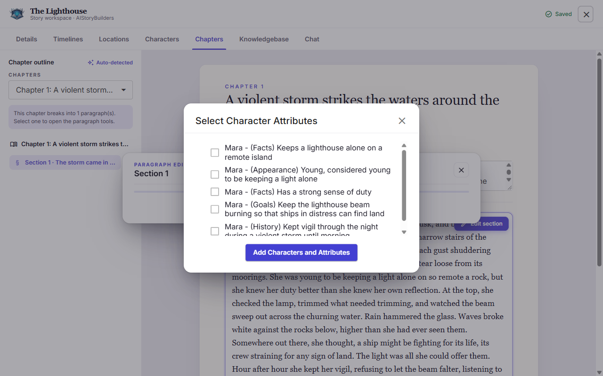

**What you should see:** the section is saved, and the characters you checked are added to the section and to the **Characters** tab.

## 10. Generate a section with AI

Use this to have the AI write or rewrite a section. It uses the chapter synopsis, the sections before it, and the section's characters, location and timeline.

1. Open the section in the editor, or click **Add section** for a new one.
2. Click the orange **AI** button.
3. Optional: describe what should happen in **Describe paragraph or provide prompt instructions (optional):**.
4. Pick the **Number of words to generate:** (10 to 1000). The default depends on how long the current text is.
5. Pick the **AI Model:**.
6. Check **Search knowledgebase** if you want the AI to use your knowledge base pages. It's turned off when the story's knowledge base is empty.
7. Click **Generate**.

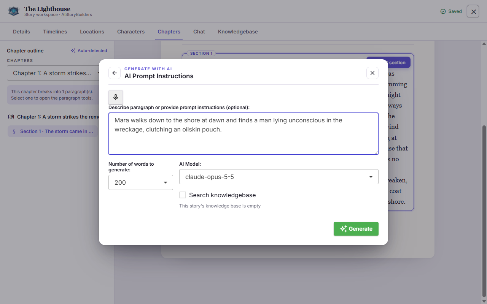

**What you should see:** **Writing…** while the AI works. Then the editor shows the new text with the note **AI rewrote this section. Use Undo to restore the previous text.** The text isn't saved yet.

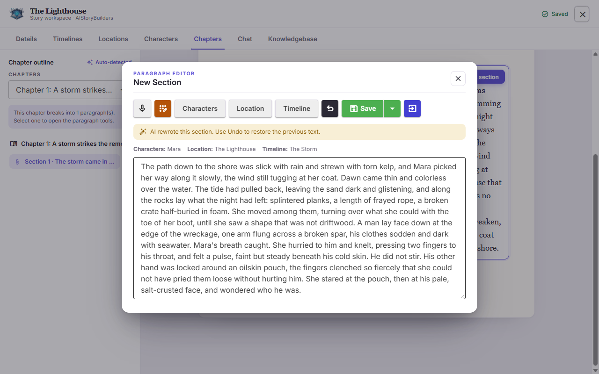

1. Read the text and edit it if you like.
2. Click **Save** to keep it, or click the **Undo** button to restore the previous text.

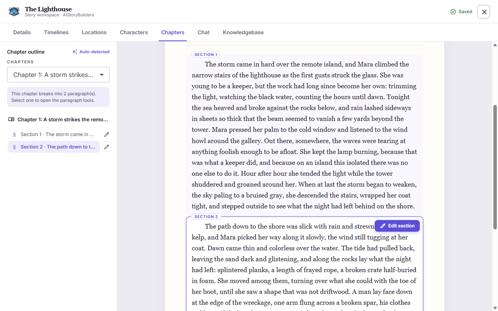

## 11. Chat with your story

Use the **Chat** tab to ask questions about your story, check for problems, or ask for changes.

1. Click the **Chat** tab. It's the last tab, to the right of **Knowledgebase**.
2. Pick a model from the list. This choice is only for this chat; it doesn't change your default model.
3. Check **Search knowledgebase** if the answer may be in your knowledge base pages, or if you want the chat to edit them.
4. Type a question in **Ask about your story...**. For example: *Are there any orphaned characters?* or *Tell me about the main characters*.
5. Press **Enter** or click **Send**. Press **Shift+Enter** for a new line.

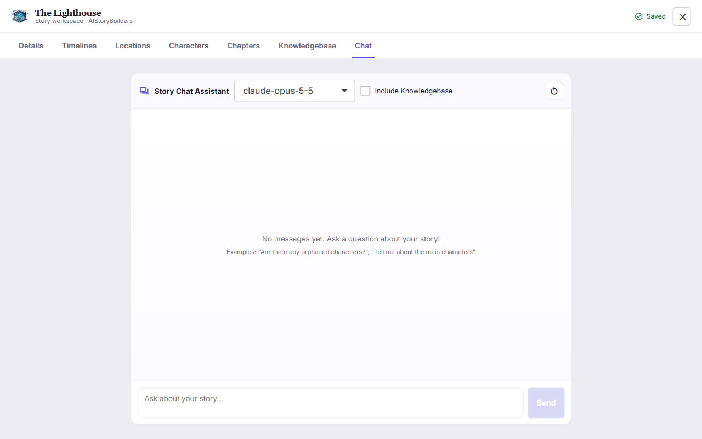

**What you should see:** **Thinking...**, then the answer. Links to knowledge base pages in the answer open that page.

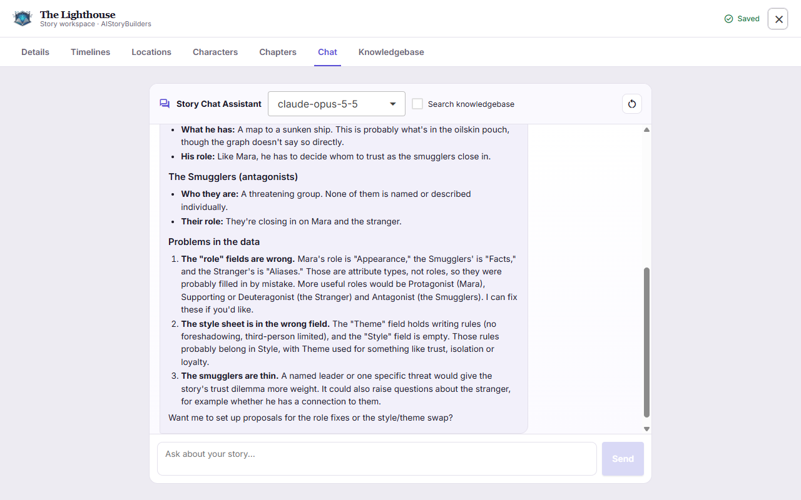

### Apply a change the AI proposes

If you ask for a change, such as *Add a new character named Captain Rourke*, the AI doesn't change the story itself. It shows a **Proposed change** card.

1. Click **Details** on the card to see exactly what will change.
2. Click **Apply** to make the change, or **Discard** to drop it.

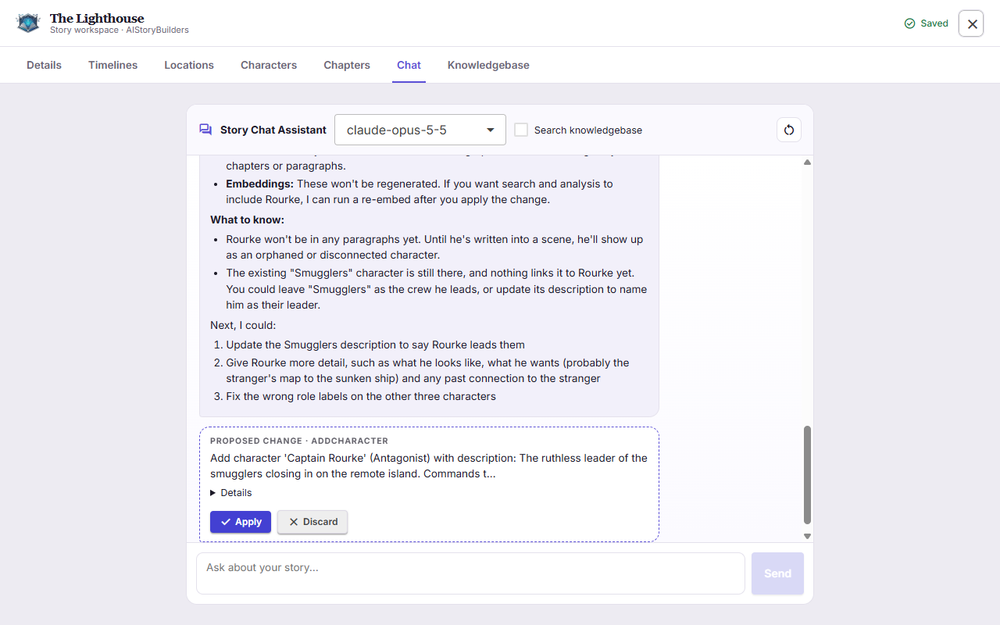

**What you should see:** a message that starts with **Applied:** or **Discarded:**. Applied changes show up on the other tabs.

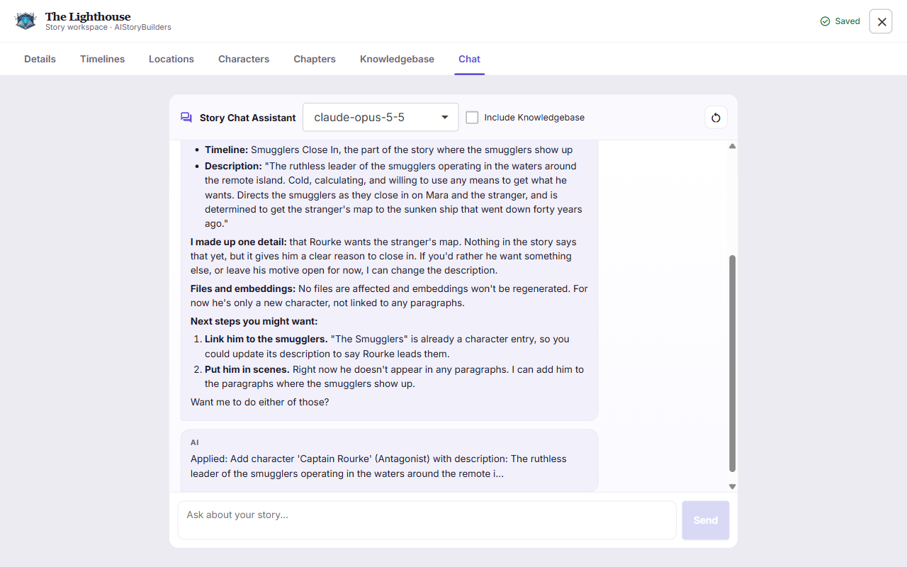

### Edit knowledge base pages from the chat

With **Search knowledgebase** checked, the chat can edit every page in your knowledge base, in any folder. Ask it to add a page, rewrite a page or delete one. For example: *Add to the Hrafnkel page that he forged the Necklace* or *Create a page Places/Village.md about the fjord village*.

Each edit is a **Proposed change** card, such as **Proposed change · kb_update_page**, just like a story change. **Details** shows the page's full new text. Nothing changes until you click **Apply**.

**What you should see:** after **Apply**, the page shows the new text the next time you open the **Knowledgebase** tab. If you saved that page yourself after the AI proposed the edit, **Apply** doesn't overwrite your text. You see **Could not apply the change:** and the page stays as you saved it. Ask the chat again to get a new proposal.

### Manage knowledge base folders from the chat

The chat can also organize your folders. Ask it to create, rename, move or delete one. For example: *Create a folder Places/North*, *Rename the Lore folder to Artifacts*, *Move the Lore folder into World* or *Delete the Drafts folder*.

Each change is a **Proposed change** card, such as **Proposed change · kb_rename_folder**. Nothing changes until you click **Apply**.

**What you should see:**

- After a rename or move, the **Applied:** message says how many pages had their links updated, so links to the moved pages keep working.
- A delete card says how many pages and subfolders go with the folder. If the number of pages or subfolders in that folder changes before you click **Apply**, the delete stops with **Could not apply the change:**, and nothing is deleted.
- The **Knowledgebase** tab shows the new folders the next time you open it.

If the knowledge base is empty, create the first page there; the chat can't see an empty knowledge base.

To start over, click the circular arrow (**Clear conversation**). The conversation is also cleared when you close the story.

## 12. Export, back up and maintain a story

All of these are on the **Details** tab.

| Button | What it does |
|---|---|
| **Save Word Doc** | Saves the whole story as a Word document (`.docx`). |
| **Export Project** | Saves the whole story, including its knowledge base, as a project file (`.stybld`). Use it as a backup, or to move a story to another computer or browser. |
| **Re-load Story** | Rebuilds the story's search data and story graph. Use it if chat answers or AI writing seem to miss recent changes. |
| **Delete** | Deletes the story, after you confirm. This can't be undone, so export it first. |

1. Click the button.
2. For **Delete** and **Re-load Story**, click **Yes** to confirm.

**What you should see:**

- **Save Word Doc** and **Export Project**: the browser downloads the file, or the Windows version asks where to save it. Then **The file was saved successfully.** appears.

  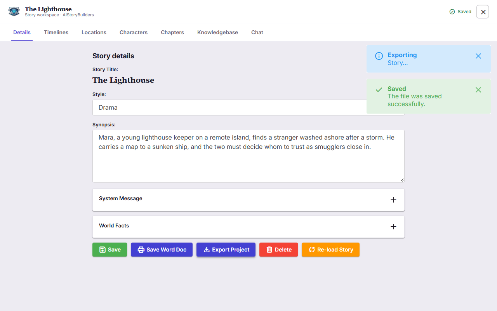

- **Re-load Story**: a progress window steps through **Step 1/5** to **Step 5/5** and ends with **Re-load complete!**. Click **Close**.

  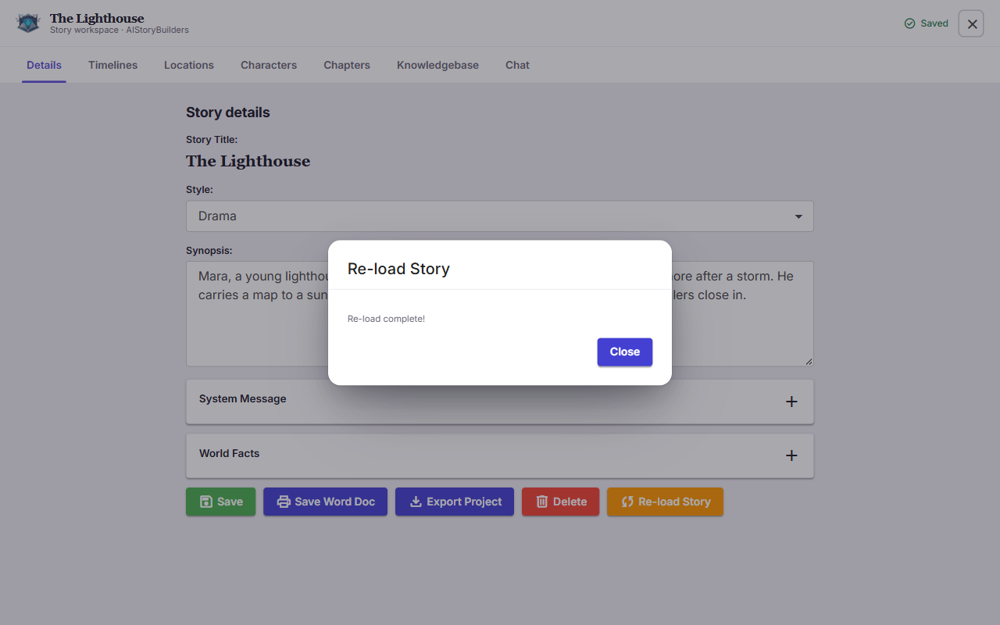

- **Delete**: you return to the library.

  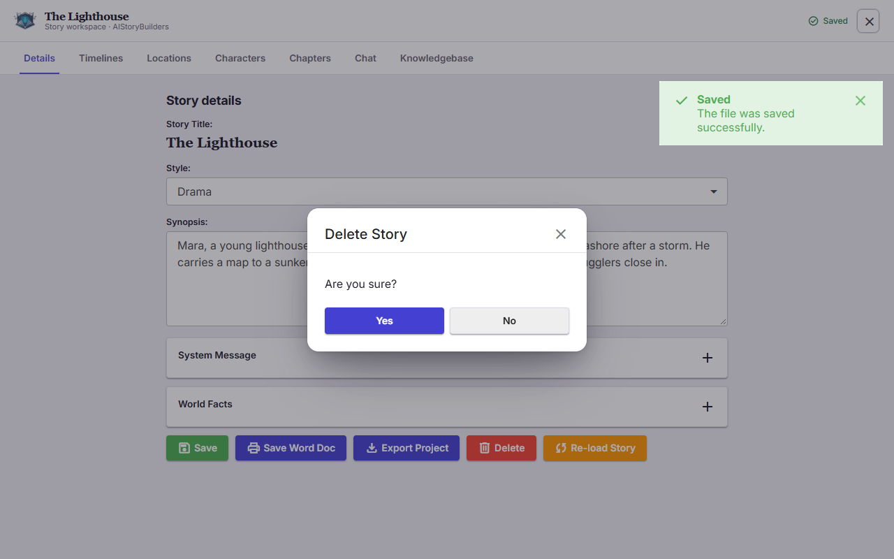

### Import a project file

Use this to restore a backup or open a story exported from another computer.

1. Click **Home**.
2. Click **Import Story**.
3. Choose a `.stybld` file of up to 50 MB.

**What you should see:** **Import Result** with **The project '`<title>`' was successfully imported.** The story appears in the library. If a story with the same title exists, the import stops. Export and delete the old story first.

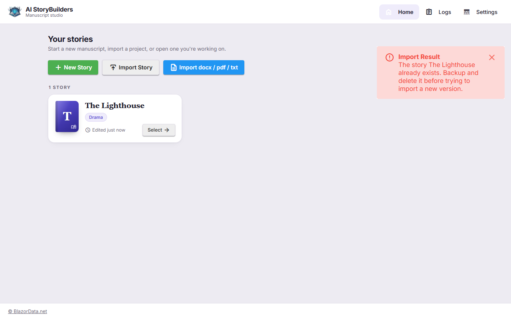

> **Browser version:** Each browser keeps its own stories. Export a project to move it to another browser or computer. Clearing the browser's site data deletes your stories, so export the ones you want to keep.

## 13. Build a knowledge base

Each story can have a knowledge base: your own Markdown notes, such as world history, magic rules or research. The pages are separate from the characters, locations and timelines. Link pages to each other with `[[Page name]]`. The AI reads them when you check **Search knowledgebase** in the AI prompt or in the chat, and the chat can also propose edits to them (see [Edit knowledge base pages from the chat](#edit-knowledge-base-pages-from-the-chat)).

### Create a page

1. Click the **Knowledgebase** tab.
2. Click **Create first page**, or the new page icon (**New page**) in **EXPLORER**.
3. Type the **Page name** and click **Create**.

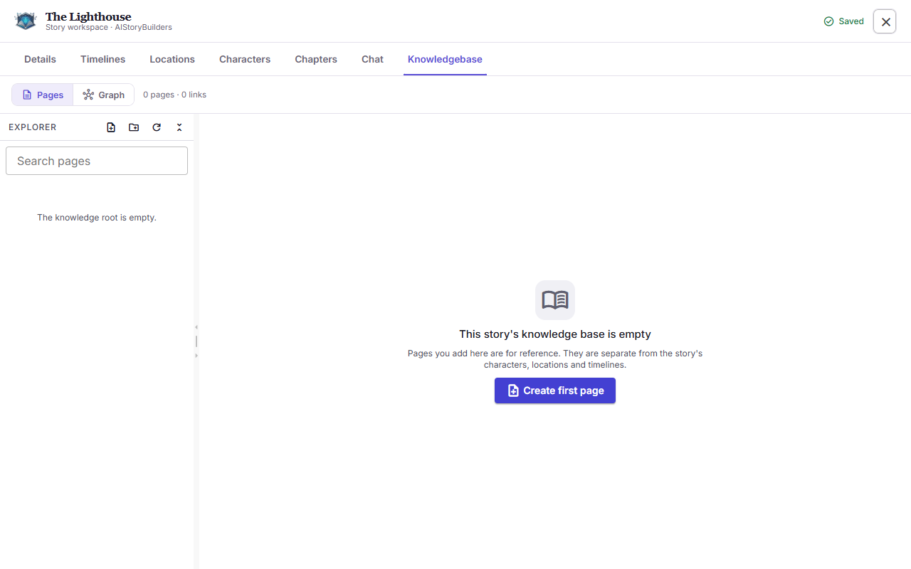

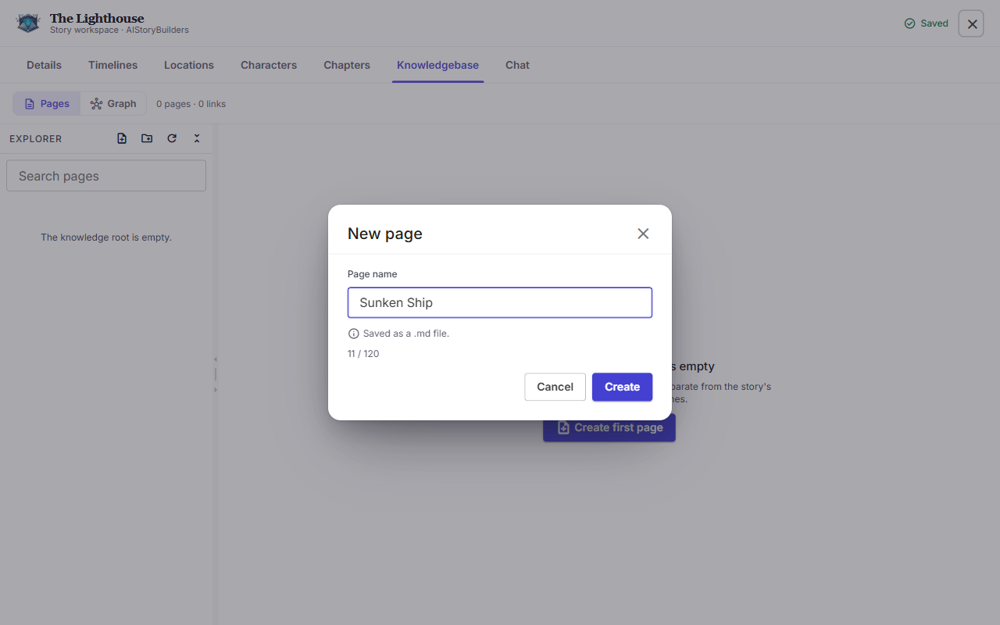

### Write a page

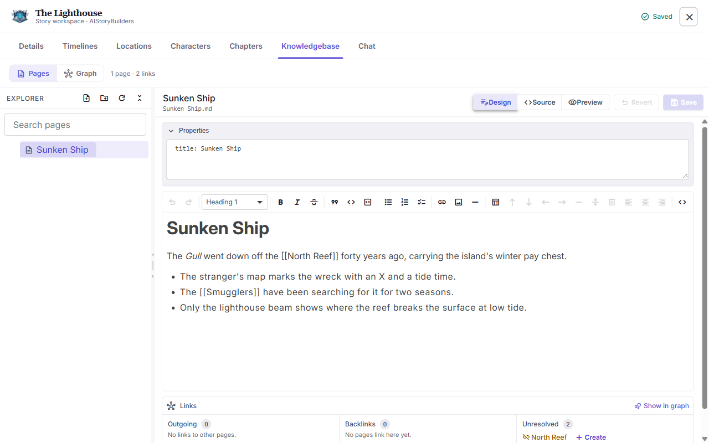

1. Write in **Design** (formatted), **Source** (plain Markdown) or **Preview** (read-only).
2. To link to another page, type its name in double brackets, for example `[[Sunken Ship]]`.
3. Click **Save**, or press **Ctrl+S**. **Revert** throws away unsaved edits.

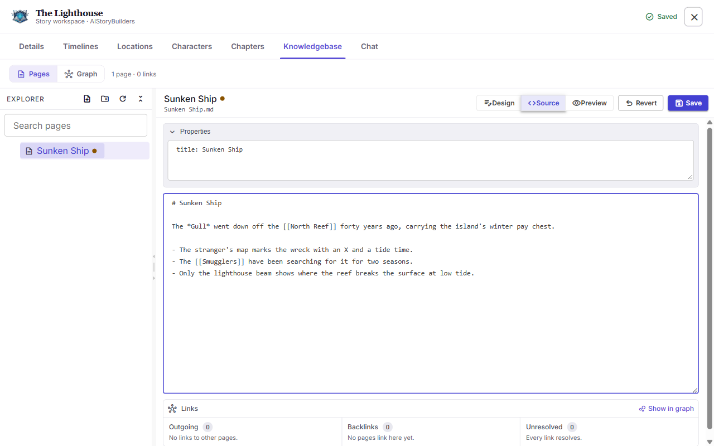

**What you should see:** **Saved**. In **Preview**, links to pages that don't exist yet are marked **(unresolved)**.

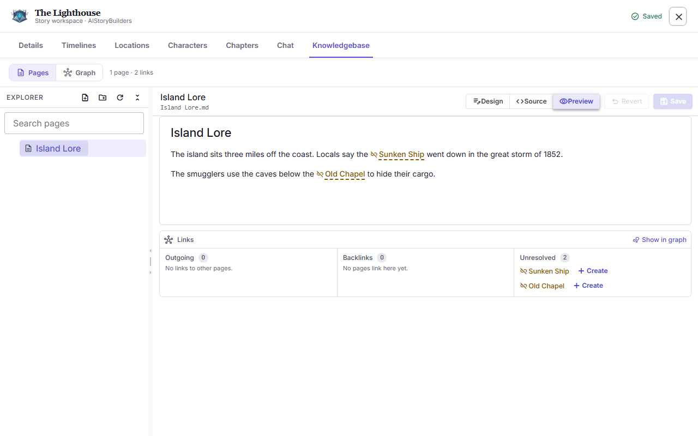

The **Links** panel lists the page's **Outgoing** links, its **Backlinks**, and **Unresolved** links. Click **Create** next to an unresolved link to make that page.

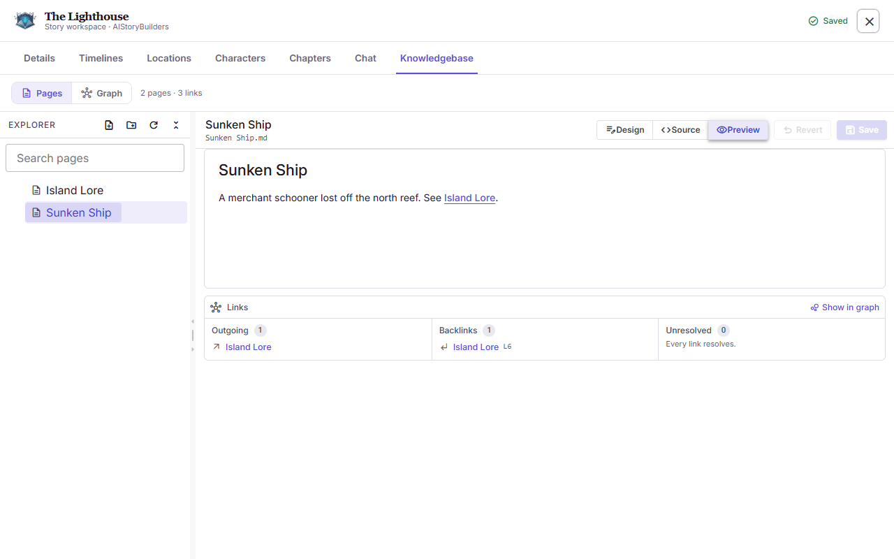

### Organize pages

- Click the new folder icon (**New folder**) to add a folder.
- Type in **Search pages** to find a page. Press **Esc** to clear the search.
- Right-click a page or folder for **Open**, **New page here**, **New folder here**, **Rename (F2)**, **Move to…** and **Delete (Del)**. You can also drag pages into folders.
- When you rename or move a page, the app updates the links to it in other pages.

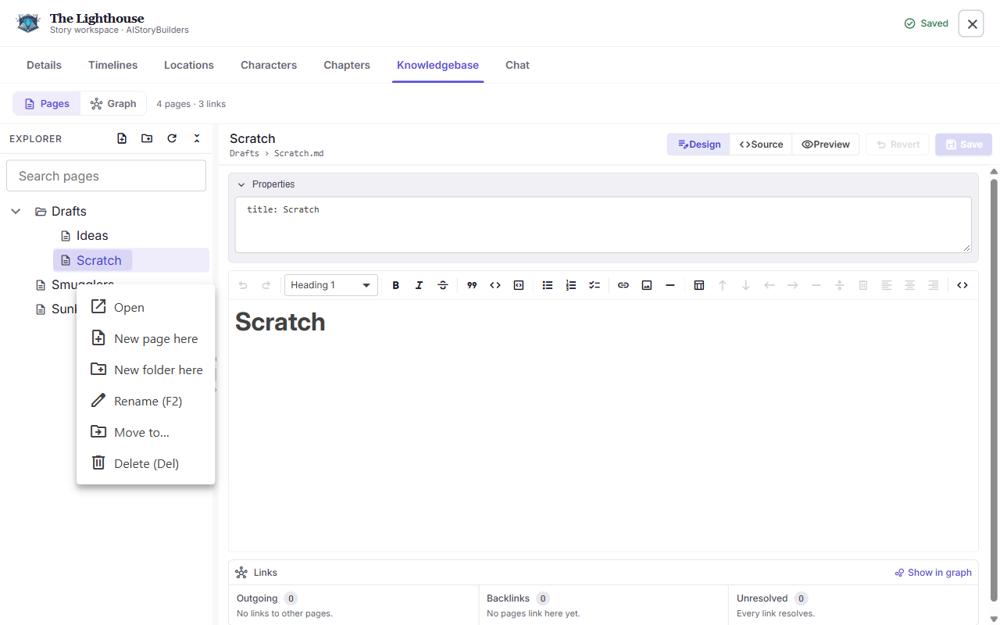

> **Deleting pages:** In the Windows version, deleted pages go to the Recycle Bin. In the browser version, they're deleted permanently. The confirmation offers **Export first** so you can back up the story.

### Explore the graph

1. Click **Graph** at the top of the **Knowledgebase** tab.

   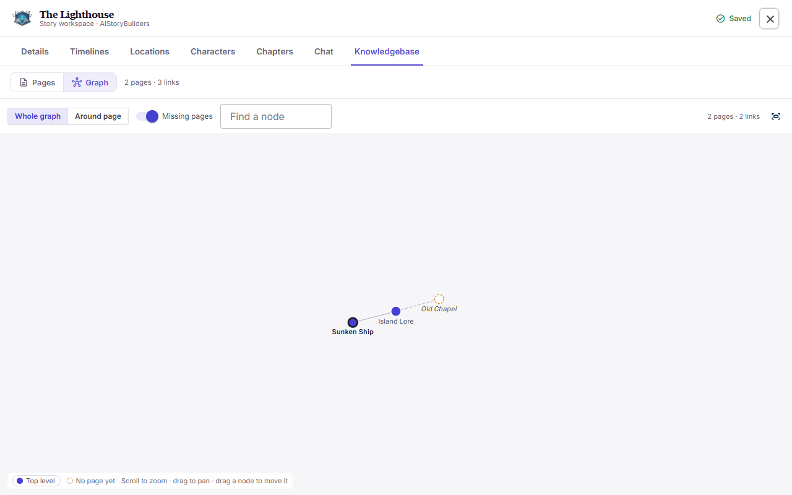

2. Choose **Whole graph**, or **Around page** to see only the pages near the open page. With **Around page**, pick how many links away to show.
3. Turn **Missing pages** on or off. Missing pages are links to pages that don't exist yet, shown with a dashed outline.
4. Type in **Find a node** to find a page. Press **Enter** for the next match.
5. Click a page to see its details. Click **Open** to edit it, **Show around** to center the graph on it, or **Create page** for a missing page.

Scroll to zoom, drag to pan, and drag a page to move it. The legend chips at the bottom show or hide each top-level folder.

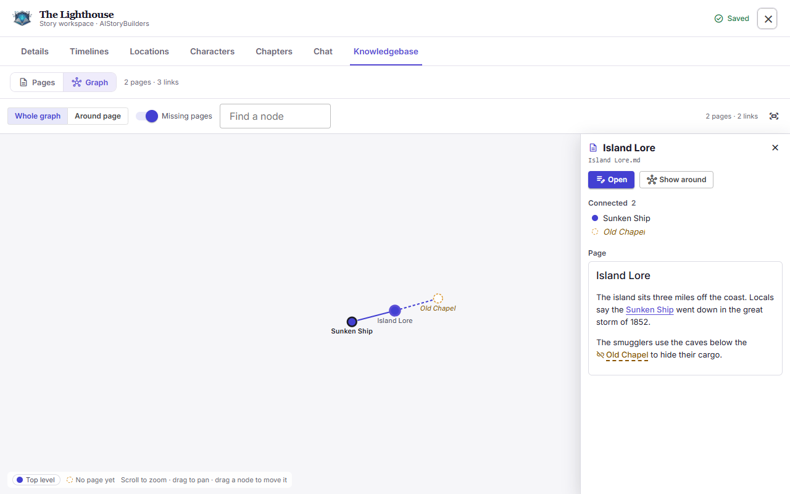

## 14. Check the log

The log records what the app did and any errors. Check it when something doesn't work.

1. Click **Logs** in the top menu.
2. Read the **Date** and **Entry** columns. The newest entries are first.
3. Click **Export Log** to save the log as a web page, for example to send to support.
4. Click **Clear Log**, then **Yes**, to empty it.

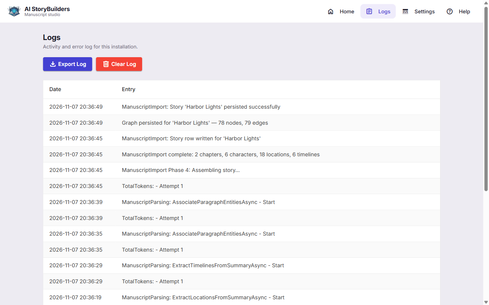

## Troubleshooting

Most problems show a message in the top-right corner, like this one:

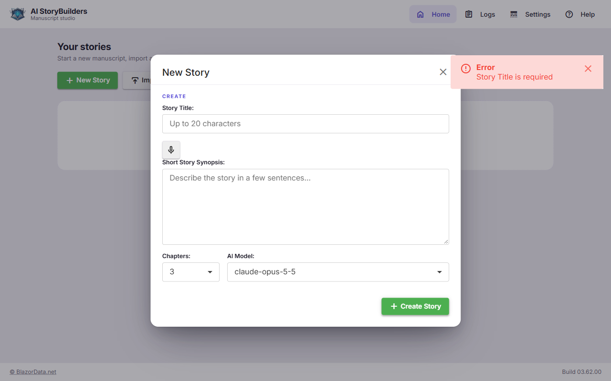

| Symptom | Cause | Fix |
|---|---|---|
| The app opens on **Settings**, or the library shows "Connect an AI provider and verify a model before you create or write stories." | No AI provider is set up, or no model is verified. | Follow [1. Connect an AI provider](#1-connect-an-ai-provider). |
| **Create Story** or **Generate** is greyed out, and the model list says "No verified models. Verify a model in Settings." | There's no verified model. | Click **Open Settings**, then save a model so it's verified. |
| "Invalid API Key - must start with: sk-" | The OpenAI key is incomplete or isn't an OpenAI key. | Copy the full key again from OpenAI. |
| "Enter an API key.", "Enter the endpoint URL." or "Pick or type a model name." | A required field is empty. | Fill in the field and click **Save**. |
| "Enter a full URL that starts with https:// or http://." | The endpoint isn't a full web address. | Enter it like `https://<resource>.openai.azure.com/`. |
| "`<model>` did not pass the `<stage>` check: `<message>` Nothing was saved." | The model failed the app's test. It couldn't connect, call a tool, or read a small story graph correctly. | Check the key and endpoint. If the stage is "tool call" or "knowledge graph", pick a larger, newer model. |
| "The provider rejected the API key (`<code>`). Check the key in Settings." | The key is wrong, expired or has no credit. | Click **Replace** and paste a valid key. |
| "The browser blocked the request to `<host>`, or it couldn't be reached." | Browser version only. The provider doesn't allow requests from this web page, or the host is down. | For Ollama, set `OLLAMA_ORIGINS` to the app's address on the computer running Ollama. For Azure OpenAI, allow the app's address in the resource's CORS settings. |
| "Model '`<model>`' has not passed the capability check. Verify it in Settings." | The model you picked was removed from **Verified models**, or you changed provider. | Add the model again under **Verified models**, or pick another model. |
| "Add an API key in Settings" | The key was cleared. | Enter a key in **Settings** and click **Save**. |
| "AI provider authentication failed: `<message>`" | The provider refused the key during an AI task. | Check or replace the key in **Settings**. |
| "Story Title is required" | The title is empty. | Type a title. |
| "Story Title cannot contain / \ : * ? " < > \| or #", "Story Title cannot contain '..'." or "Story Title cannot start or end with a space or a dot." | The title has characters that can't be used in a file name. | Remove those characters. |
| "'`<title>`' is a reserved name. Choose another title." | Windows reserves that name, for example `CON` or `NUL`. | Pick another title. |
| "Story name already exists" | Another story has the same title, ignoring capitals. | Pick another title, or delete the old story. |
| "The story `<title>` already exists. Backup and delete it before trying to import a new version." | You imported a project whose story is already in the library. | Export the existing story, delete it, then import again. |
| "The version of the file you are trying to import is not compatible with this version of AI Story Builders. …" | The project file is from a newer version, or isn't a valid project. | Update AI StoryBuilders, or export the project again. |
| "The file is larger than 50 MB." | The file is over the import limit. | Split the manuscript, or remove images from it. |
| "Unsupported file format: `<extension>`" | The manuscript isn't a `.docx`, `.pdf`, `.txt` or `.md` file. | Save it in one of those formats. |
| "A story named '`<title>`' already exists. Rename or delete it first." | The manuscript's file name matches an existing story. | Rename the file, or delete the existing story. |
| "Timeline Name is required", "Location Name is required" or "Character Name is required" | The name is empty. | Type a name. |
| "Timeline Name already exists. Choose a new name", "Location Name already exists. Choose a new name" or "Character Name already exists. Choose a new name" | Another item of that kind has the same name. | Pick a different name. |
| "Start Date is required" or "Start Date must be before Stop Date" | The timeline dates are missing or in the wrong order. | Set a start date before the stop date. |
| "Description is required" | A location description or character background is empty. | Type a description. |
| "Synopsis is required" | A new chapter needs a synopsis. | Type a short synopsis. |
| "Paragraph content is required" | You saved an empty section. | Type some text, or use **Delete section**. |
| **Generate** finishes but the section is empty. | The provider returned an error the app couldn't recover from. | Click **Undo**, then try again or pick another model. Check **Logs** for details. |
| **Search knowledgebase** is greyed out: "This story's knowledge base is empty" | The story has no knowledge base pages. | Add a page on the **Knowledgebase** tab. |
| "The knowledge base search timed out. The paragraph was written without it." | The knowledge base search took too long. | The text was still written. Generate again if you need the notes used. |
| A chat answer shows "Error: `<message>`" and **Retry**. | The provider returned an error. | Click **Retry**. If it keeps failing, check **Settings** and **Logs**. |
| "This change is no longer pending." | That proposed change was already applied or discarded. | Ask the chat for the change again. |
| "Browser storage is full. Your latest changes are kept in this tab but are not saved." | Browser version only. The browser's space for stories (about 5 MB) is used up. | Click **Export Project** to save a copy. Delete stories you don't need from the library, then click **Retry**. |
| "Browser storage is almost full. Export the stories you want to keep, and delete the ones you don't need." | Browser version only. Storage is 80% full or more. | Export and delete stories you don't need. |
| The save indicator shows **Save failed**. | Browser version only. The last save didn't finish. | Click **Retry**. |
| A story card shows "Story data is missing from browser storage". | Browser version only. The story's data was removed, for example when site data was cleared. | Click **Remove from library**, then use **Import Story** with your latest `.stybld` backup. |
| "This story was changed in another tab" | Browser version only. The same story is open in two tabs. | Click **Reload** to load the other tab's changes, or **Keep mine** to keep yours. Use one tab at a time. |
| "This story doesn't exist." | The link points to a story that was deleted or renamed. | Click **Back to library**. |
| "Names can't contain '/' or '\'." or "'`<name>`' already exists in this folder." | A knowledge base page or folder name isn't allowed. | Pick another name. |
| "Page too large" | A knowledge base page is over 1 MB. | Split it into smaller pages. |
| **This page changed** | The page was changed somewhere else while you edited it. | Click **Reload** to get the latest version, or **Overwrite** to keep your text. |

## Frequently asked questions

**Can I use AI StoryBuilders V1 and this version together?**
Yes. The Windows version reads and writes the same story files as V1, in your `Documents\AIStoryBuilders` folder. Run only one of them at a time. If both edit the same story at once, the last save wins.

**Where are my stories stored?**
In the Windows version, in `Documents\AIStoryBuilders`, one folder per story. In the browser version, in that browser's storage, on your computer only. Use **Export Project** to back up either one.

**Is my story sent to the cloud?**
Only the text the AI needs for a task is sent, and only to the provider you picked in **Settings**. Search data (embeddings) is made on your computer. With Ollama, nothing leaves the computer that runs it.

**Why isn't my model in the list?**
Only verified models are listed. Add the model under **Verified models** in **Settings**. If it fails the check, it can't reliably do the app's AI tasks.

**Can the chat change my story without asking?**
No. The chat can only propose changes. Nothing changes until you click **Apply**.

**Why is there no microphone button?**
Dictation is only in the browser version.

**How do I move a story to another computer or browser?**
Click **Export Project** on the **Details** tab. On the other computer or browser, click **Import Story** on the **Home** page and choose the file.
