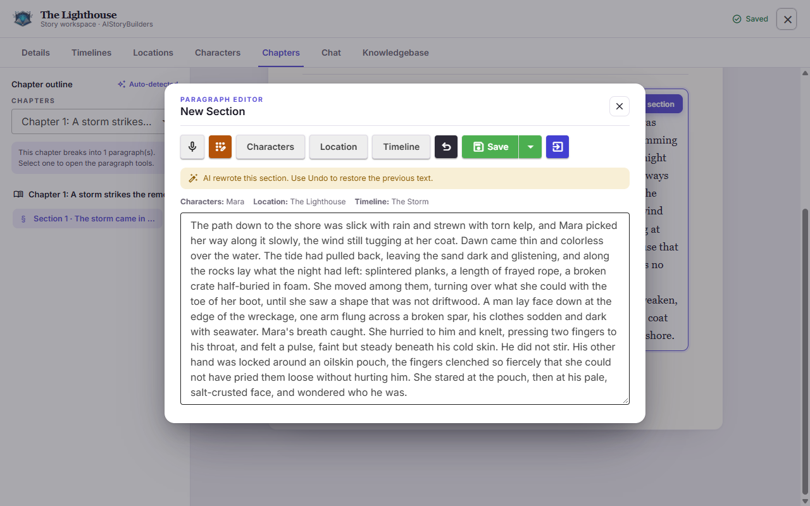

# AIStoryBuildersV2


Write your next novel faster and easier.



* [Website](https://aistorybuilders.com/)
* [User guide](Docs/User-Guide.md) (also shown in the app on the **Help** page)

## A Project of [AIStoryBuilders](https://github.com/AIStoryBuilders)

* [AIStoryBuilders](https://github.com/AIStoryBuilders/AIStoryBuilders): V1, the original Windows app. V2's
  Windows app reads and writes its story files unchanged.
* [AIStoryBuildersOnline](https://github.com/AIStoryBuilders/AIStoryBuildersOnline): the V1 browser version. V2's
  browser app has replaced it at [online.aistorybuilders.com](https://online.aistorybuilders.com/)
* [AIOrchestrator](https://github.com/AIStoryBuilders/AIOrchestrator)

## About V2

AI StoryBuilders V2 on **.NET 11** (release candidate): a **Windows MAUI Blazor Hybrid** app and a
server-less **Blazor WebAssembly** app that share one Razor class library. The structure follows
[KnowledgeGraphBuilder](https://github.com/ADefWebserver/KnowledgeGraphBuilder). Aspire is used
only at development time to launch both apps.

The implementation plan is [Docs/AIStoryBuildersV2-Plan.md](Docs/AIStoryBuildersV2-Plan.md), and
the rules for contributors and agents are in [AGENTS.md](AGENTS.md).

## Projects

| Project | Kind | Purpose |
|---------|------|---------|
| `AIStoryBuildersV2` | MAUI (`net11.0-windows10.0.19041.0`) | Desktop shell; hosts the Blazor UI in a `BlazorWebView` |
| `AIStoryBuildersV2.Web` | Blazor WebAssembly (`net11.0`) | Browser app (static files only); hosts the same UI |
| `AIStoryBuildersV2.Shared` | Razor class library | **All shared UI and app logic lives here** |
| `AIStoryBuildersV2.AppHost` | Aspire AppHost | Dev-time only: launches the Windows app and the WASM dev server |
| `AIStoryBuildersV2.ServiceDefaults` | Aspire shared | Kept in the solution, referenced by nothing |
| `AIStoryBuildersV2.Tests` | xUnit | Tests |

The Android, iOS and Mac Catalyst targets are opt-in: pass `-p:IncludeMobileTargets=true`
(iOS and Mac Catalyst need macOS). Only Windows is a supported target.

## Build and test

Requires the .NET SDK `11.0.100-rc.3` (pinned in `global.json`) and the `maui-windows` workload.
See [Docs/Dev-Environment.md](Docs/Dev-Environment.md).

```bash
dotnet build AIStoryBuildersV2/AIStoryBuildersV2.csproj -f net11.0-windows10.0.19041.0
```

```bash
dotnet build AIStoryBuildersV2.Web/AIStoryBuildersV2.Web.csproj
```

```bash
dotnet test AIStoryBuildersV2.Tests/AIStoryBuildersV2.Tests.csproj
```

Run the web app with `dotnet run --project AIStoryBuildersV2.Web`, or run both apps with
`aspire run` from the repository root.

## Data structure

V2 uses the same story data as V1 ([Docs/V1-File-Format.md](Docs/V1-File-Format.md)), plus an optional Knowledge
Base per story.


- **Story**
  - *Title*
  - *Style*
  - *Synopsis*

- **Timelines**
  - *Timeline Name*
  - *Description*
  - *StartDate*
  - *EndDate* (nullable)

- **Locations**
  - *Location Name*
  - *Descriptions*
    - *Description Type*
    - *Timeline Name*

- **Characters**
  - *Character Name*
  - *Descriptions*
    - *Description Type*
    - *Timeline Name*

- **Chapters**
  - *Synopsis*
  - *Paragraphs*
    - *Content*
    - *Timeline Name*
    - *Location Name*
    - *Characters*

- **Knowledge Base** (V2 only, optional)
  - *Pages* (Markdown files in `{Title}/KnowledgeBase/`)

## Where your stories live

| App | Location |
|-----|----------|
| Windows (MAUI) | `Documents\AIStoryBuilders`, the same folder and file format as AI StoryBuilders V1. Settings are in the app's preferences; the API key is in Windows SecureStorage. |
| Browser (WASM) | This browser's `localStorage`: one zipped story per key (`asb2:story:{Title}`), plus `asb2:stories`, `asb2:settings` and `asb2:log`. |

Each story can have a **Knowledge Base**: Markdown pages in `{Title}/KnowledgeBase/`. The folder is created only
when the first page is added, so V1 never sees a change to stories that have none, and it travels with the story
in `.stybld` exports.

### Using V1 and V2 together (Windows)

V2 reads and writes V1's story files unchanged, so both apps can open the same stories. **Run one app at a time:**
if both edit the same story at once, the last save wins. V2 never reads or changes V1's
`AIStoryBuildersSettings.config` or `ModelCache\`; that file may still hold a V1 API key in plain text.

### Browser storage

- Browser storage is small (often about 5 MB per site). When it is full, the workspace shows a banner, your
  latest changes stay in the tab, and **Export Project** (Details tab) saves a `.stybld` copy.
- **Clearing this site's data deletes your stories.** Export the ones you want to keep.
- The API key is stored in plain text in this browser and is sent only to the chosen provider. Use a key with a
  spending limit and use **Clear key** on shared computers.

## AI models must pass a capability check

Settings accepts a model only after a short probe passes: it connects, makes a tool call and returns parseable
JSON. Only verified models appear in the model lists. Embeddings always run locally (ONNX all-MiniLM-L6-v2), in
both apps.

In the browser, each provider must allow cross-origin requests:

- **Azure OpenAI**: add the site's origin to the resource's CORS settings.
- **Ollama**: start it with `OLLAMA_ORIGINS` set to the site's origin.
- **Google AI** and the others work from the browser with a normal key; the connect step of the probe reports
  any CORS failure.

## Publishing the browser app

```bash
dotnet publish AIStoryBuildersV2.Web/AIStoryBuildersV2.Web.csproj -c Release -o publish
```

Serve `publish/wwwroot` from any static file server. The server must:

- send `.wasm` as `application/wasm` and `.js`/`.mjs` as `text/javascript`;
- return `index.html` for unknown paths if you want links such as `/story/My%20Story` to survive a reload;
- for a sub-path, set `<base href="/your-path/">` in `index.html`.

On IIS or Windows Azure App Service, deploy the `web.config` and `wwwroot` from the publish folder together. The
`web.config` does all of the above, and has the MIME types IIS lacks for `.onnx` and `.mjs`.

No file is loaded from a CDN: the ONNX runtime, the model and the fonts are in the publish output.

## License

AI StoryBuilders V2 is released under the [MIT License](LICENSE). The third-party packages below keep their own
licenses.

## Third-party licenses

Most packages are MIT, Apache-2.0 or BSD. One is not, and it allows only non-commercial use:

| Package | Used for | License |
|---------|----------|---------|
| [Xceed DocX](https://github.com/xceedsoftware/DocX) 5.0.0 | Word export and `.docx` manuscript import | Xceed Community License: non-commercial use, fewer than 10 users, and the Xceed copyright notice must be shown |

Copyright © Xceed Software Inc. (DocX). Commercial use of AI StoryBuilders V2 needs a commercial license for
DocX. EPPlus and ExcelDataReader were used only by the Utility screens, which were removed (plan D23), so
they are no longer included. Others: Radzen.Blazor, Markdig, YamlDotNet, Newtonsoft.Json,
Blazored.LocalStorage, OllamaSharp, Microsoft.Extensions.AI, OpenAI and Azure.AI.OpenAI (MIT); DiffPlex
(Apache-2.0); PdfPig and onnxruntime-web (Apache-2.0 / MIT); Microsoft.ML.OnnxRuntime (MIT).

## The UI is specified in `Docs/Design`

The screens are specified in [`Docs/Design/DESIGN.md`](Docs/Design/DESIGN.md) and the interactive
artboards, with behavior in [`Docs/UI-Behavior-Spec.md`](Docs/UI-Behavior-Spec.md).
